# NarSil 1.4.0

NarSil 1.4.0 is an almost-faithful rewrite of Sil 1.3.0 using modern Angband code, with changes to identifying of objects and the way the dungeon is perceived.

An attempt at remaining faithful to Sil 1.3.0 is maintained on the [NarSil 1.3 branch](https://github.com/NickMcConnell/NarSil/tree/1.3).

---

## Android port (this fork)

This fork's default branch, `android`, is a mobile-first Android port of NarSil: the game's core runs unmodified on its own thread, and everything you touch is a native screen instead of the text terminal. The details are in [`android/README.md`](android/README.md); the plans are in [`plans/`](plans/).

<table>
<tr>
<td align="center" width="25%">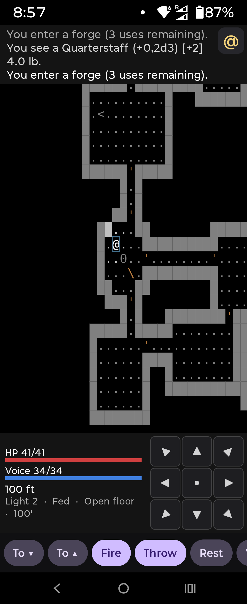 <b>Map.</b> Tap to step or walk, long-press to inspect; status, d-pad and one-tap actions underneath.</td>
<td align="center" width="25%">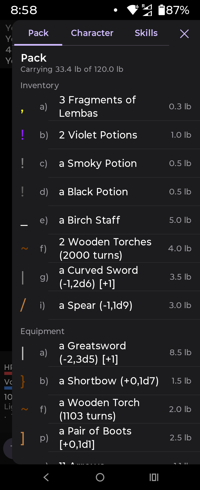 <b>Pack.</b> Inventory and equipment in one list, one row expanded at a time.</td>
<td align="center" width="25%">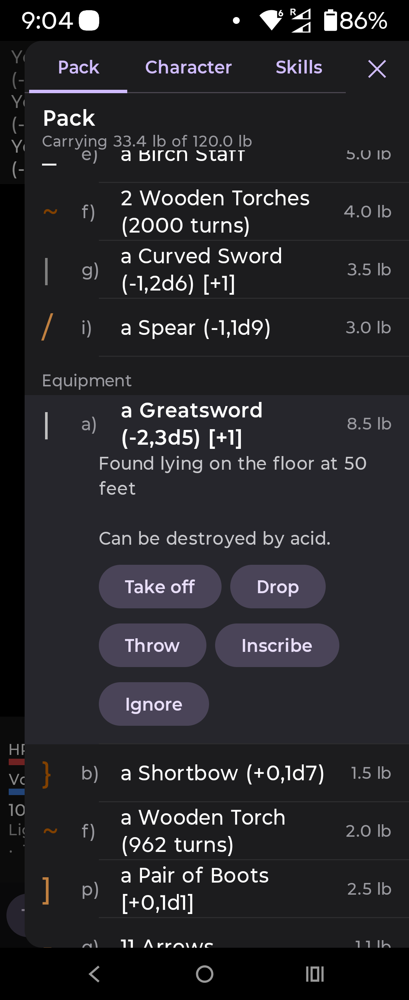 <b>Item actions.</b> Take off, Drop, Throw, Inscribe, Ignore; the pack stays open afterwards.</td>
<td align="center" width="25%">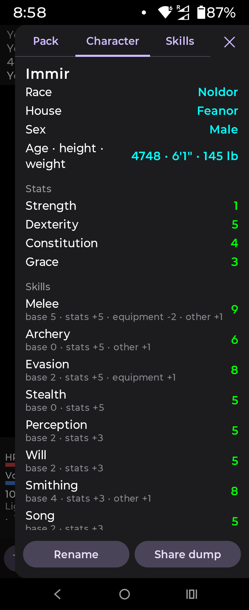 <b>Character.</b> Stats and every skill, with where each total comes from.</td>
</tr>
<tr>
<td align="center">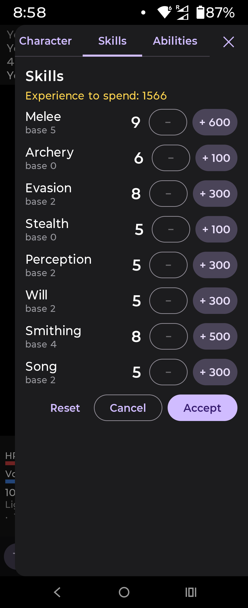 <b>Skills.</b> Spend experience, undo until you accept.</td>
<td align="center">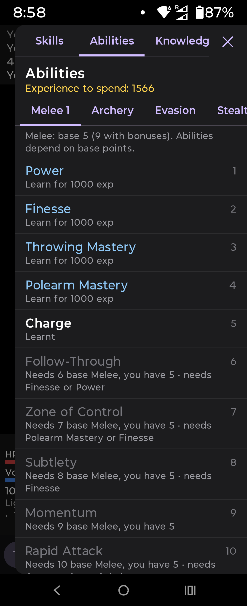 <b>Abilities.</b> One tab per skill, with what each one still needs.</td>
<td align="center">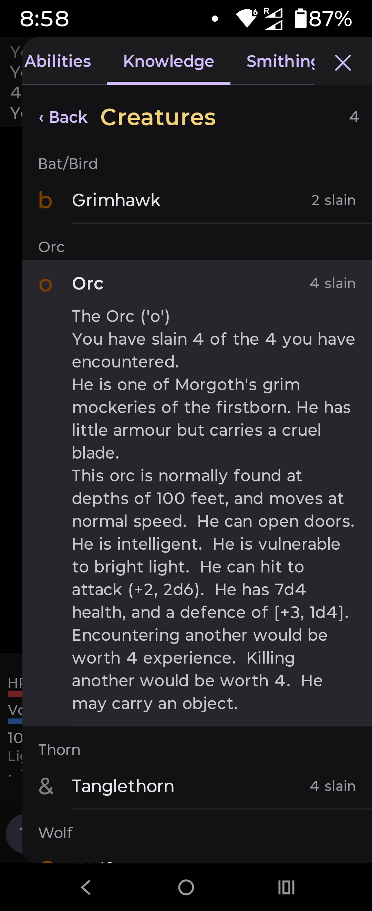 <b>Knowledge.</b> Creatures, objects, runes, terrain and more, with lore and search.</td>
<td align="center">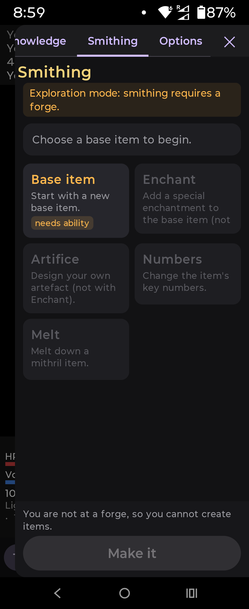 <b>Smithing.</b> Design an item; Make it at a forge.</td>
</tr>
<tr>
<td align="center">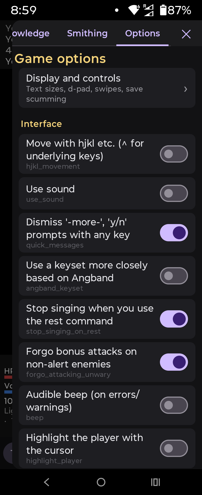 <b>Game options.</b> The game's own options as switches and sliders.</td>
<td align="center">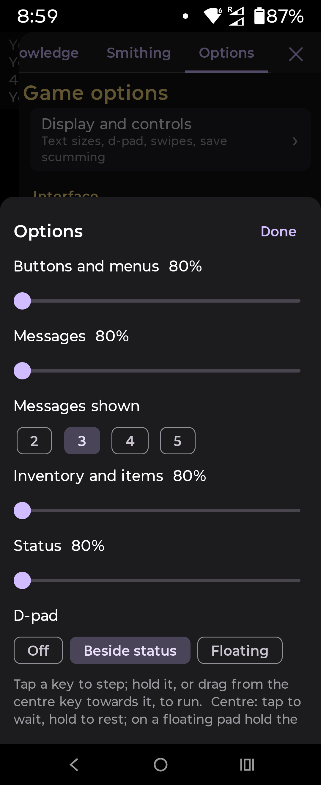 <b>App options.</b> Text sizes, d-pad style, tiles, swipes, save export and import.</td>
<td align="center">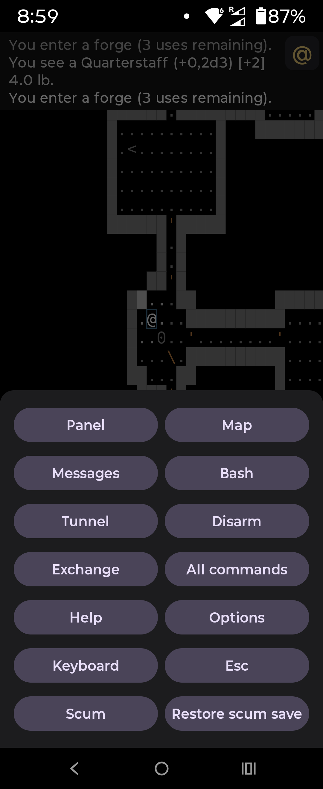 <b>Menu.</b> Everything not on the action bar, with Panel at the top.</td>
<td align="center">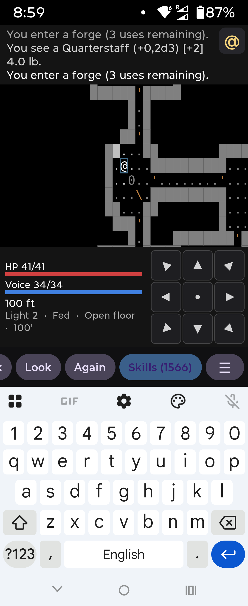 <b>Keyboard.</b> Any command by key, when you want one.</td>
</tr>
<tr>
<td colspan="4" align="center">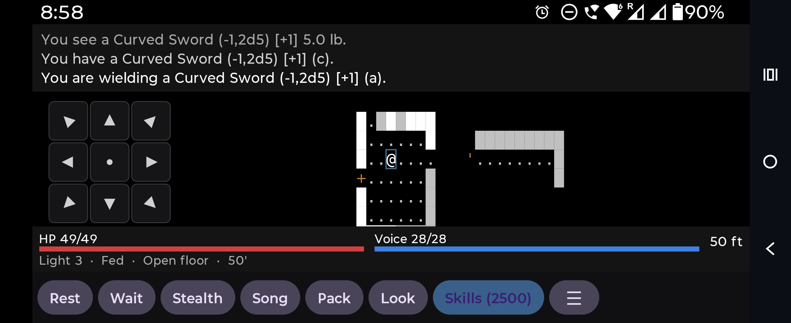 <b>Landscape.</b> Status and actions move beside the map so it gets the full height.</td>
</tr>
</table>

Build and test instructions: [`android/README.md`](android/README.md). An iOS port (SwiftUI over the same C bridge) is in progress: [`ios/README.md`](ios/README.md) and [`plans/ios.md`](plans/ios.md).
